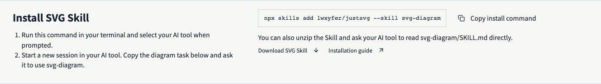

<p align="center">
  <picture>
    <source media="(prefers-color-scheme: dark)" srcset="public/brand/justsvg-wordmark-inverse.svg" />
    
  </picture>
</p>

<h1 align="center">JustSVG</h1>

<p align="center"><strong>Generate technical diagrams with AI. Refine them as native SVG.</strong></p>

<p align="center">
  <a href="https://justsvg.vercel.app/editor"><strong>Open the editor</strong></a> ·
  <a href="#install-svg-diagram-skill">Install the Skill</a> ·
  <a href="https://justsvg.vercel.app/examples">Browse examples</a> ·
  <a href="README.zh-CN.md">简体中文</a>
</p>

JustSVG is an open-source editor for architecture diagrams, flowcharts and infographics. Generate a first draft in your AI tool with SVG Diagram Skill. Then edit labels, move nodes and refine connections in the browser. Export standard SVG with editable text, shapes and groups. The online editor requires no account.

[](https://justsvg.vercel.app/editor)

## Edit your first diagram

Open an [editable RAG example](https://justsvg.vercel.app/examples?example=brand-openai-rag) and choose **Open in editor**. Double-click a label, move a node to see its bound connectors follow, then export the SVG for your README, article or slides. You can also start with an SVG you already have. [Editor guide](docs/EDITOR_GUIDE.zh-CN.md)

## Install SVG Diagram Skill

Run this command in your terminal and select your AI tool when prompted.

```sh
npx skills add lwxyfer/justsvg --skill svg-diagram
```

Start a new session in your AI tool and ask it to use `svg-diagram`. Try “Draw the request flow in this repository as editable SVG and mark any relationships inferred from the code.” The Skill returns the diagram, prompt and validation notes. Open the SVG in JustSVG to refine it.

You can also [download the Skill ZIP](https://justsvg.vercel.app/skills/svg-diagram-skill.zip), unzip it and ask your AI tool to read `svg-diagram/SKILL.md`. [Web installation guide](https://justsvg.vercel.app/#skill) · [Skill documentation](skills/svg-diagram/README.md)

[](https://justsvg.vercel.app/#skill)

## Start from a worked example

- [Agent Evals](skills/svg-diagram/examples/agent-evals/README.md) shows one evaluation workflow in three layouts. Each includes editable SVG, a prompt and a validation report.
- The [example library](https://justsvg.vercel.app/examples) has 169 editable diagrams across 66 styles. Browse layouts, adapt a diagram or reuse its prompt. Brand-inspired diagrams are visual studies based on public references.
- [Business examples](docs/BUSINESS_EXAMPLES.md) cover product, finance, operations and project coordination. Profit waterfalls and budget comparisons recalculate when you edit their data.
- [Composition templates](docs/COMPOSITE_TEMPLATES.md) give you reusable architecture, flow and chart components.

[](https://justsvg.vercel.app/examples)

JustSVG is in beta and designed for desktop browsers. It imports, edits and exports SVG. Browser-local recovery helps restore your workspace. Export SVG files for long-term storage. See the [SVG compatibility notes](docs/EDITOR_GUIDE.zh-CN.md#安全与兼容性) for supported imports.

Bug reports, compatibility cases and diagram contributions are welcome. [Report an issue](https://github.com/lwxyfer/justsvg/issues/new) · [Development and contribution guide](development.md)

## License

JustSVG source code is licensed under [MIT](LICENSE). Icons, fonts and other dependencies retain their own licenses; see [third-party notices](docs/THIRD_PARTY.md).
