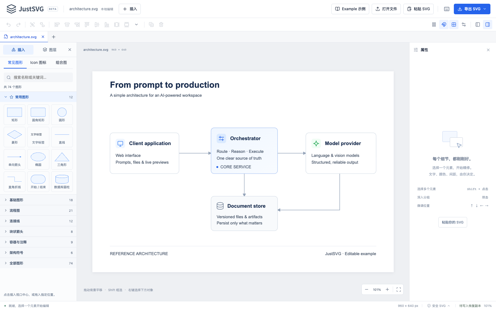
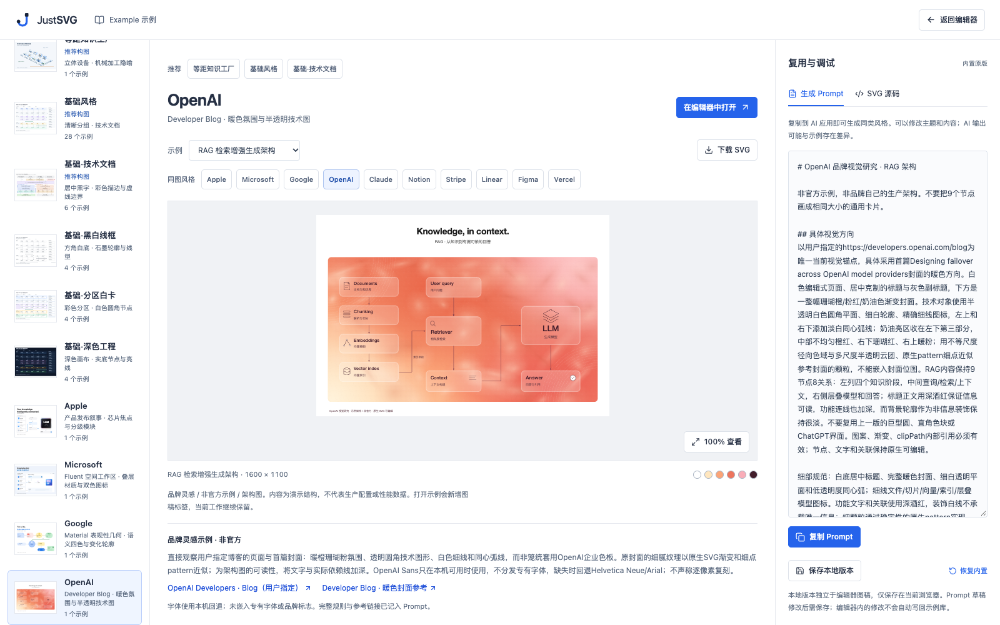

<p align="center">
  <picture>
    <source media="(prefers-color-scheme: dark)" srcset="public/brand/justsvg-wordmark-inverse.svg" />
    
  </picture>
</p>

<h1 align="center">JustSVG</h1>

<p align="center">
  <strong>Just diagrams. Just SVG.</strong><br />
  An open-source, SVG-native alternative to draw.io.
</p>

<p align="center">
  <a href="LICENSE"></a>
  
</p>

<p align="center">
  <a href="https://justsvg.vercel.app/">Live demo</a> ·
  <a href="#quickstart">Quickstart</a> ·
  <a href="#svg-diagram-skill">SVG Skill</a> ·
  <a href="#style-library">Style library</a> ·
  <a href="#contributing">Contributing</a> ·
  <a href="README.zh-CN.md">简体中文</a>
</p>

JustSVG pairs a browser-based SVG editor with SVG Diagram Skill. Generate architecture diagrams, flowcharts and infographics in your AI tool, or start from an editable example. Refine the result in the editor and export standard SVG with editable text, shapes and groups.



## SVG Skill + editor

| Component             | What you do                                                                                                            | Start here                          |
| --------------------- | ---------------------------------------------------------------------------------------------------------------------- | ----------------------------------- |
| **SVG Diagram Skill** | Give your AI agent a diagram brief and a visual reference. Get native SVG, the generation prompt and validation notes. | [Use the Skill](#svg-diagram-skill) |
| **SVG editor**        | Open the SVG, edit text and shapes, move nodes and refine connections. Save the result as SVG.                         | [Open the editor](https://justsvg.vercel.app/editor) |

The Skill can run independently of the editor. The web app prepares prompts and edits files; generation happens in your AI tool.

## What you can do

- **Edit native SVG.** Work with text, shapes, groups, gradients and internal references. Inspect and edit the SVG source when you need it.
- **Keep connections attached.** Bound lines and arrows follow nodes when you move, resize or align them. Imported connections can be linked to nodes in the editor.
- **Start from a style.** Browse 169 editable examples across 66 styles, including 39 brand-inspired studies, fictional worlds and an academic methods figure. Each example includes a reusable generation prompt.
- **Start from your role.** Product, finance, operations and project shortcuts lead to 12 business subjects in two working styles. Profit bridges and budget comparisons support data editing with synchronized geometry, totals and undo. [Business examples](docs/BUSINESS_EXAMPLES.md).
- **Build with reusable parts.** Insert 24 composition templates, diagram shapes, bundled Lucide icons or your own SVG components.
- **Work locally.** Edit without an account or backend. The editor keeps browser-local recovery copies; export SVG files for storage and sharing.
- **Add SVG motion.** Configure flow effects on connections and opacity effects on objects. Export an animated SVG or a static version for documents.

## Quickstart

For local setup, see the [development guide](development.md#local-development).

To edit your first diagram:

1. Open an example, drag in an `.svg` file, or paste SVG source.
2. Double-click text to edit it. Move or resize nodes, adjust colors and refine the layout.
3. Export the SVG. Open it in a browser or import it again to continue editing.

The [editor guide](docs/EDITOR_GUIDE.zh-CN.md) covers shortcuts, grouping, linked connectors, motion and recovery.

## SVG Diagram Skill

Install it with the Skills CLI:

```sh
npx skills add lwxyfer/justsvg --skill svg-diagram
```

Use the Skill in an AI agent that can read local files. From this repository, give it a task such as:

```text
Read skills/svg-diagram/SKILL.md.

Create an editable SVG architecture diagram:
- Client → API → queue → worker
- API → database

Use a clear technical-document style. Keep text and groups editable.
Return the SVG, the complete generation prompt and validation notes.
```

For repeated use, install the entire `skills/svg-diagram/` directory in your agent's supported skills location. Keep its references, scripts, examples and license together. See the [installation and usage guide](skills/svg-diagram/README.md).

The Skill includes a prompt template, an SVG contract, structural checks, browser checks and worked architecture/flowchart examples. Validation scripts have their own dependencies; see the [validation guide](skills/svg-diagram/references/validation.md).

## Style library

Compare how the same RAG architecture reads in different brand-inspired compositions, then open an example to edit it or reuse its prompt.


The library also covers system and deployment architecture, swimlanes, sequence diagrams, entity relationships, infographics, data flows and roadmaps. Five base treatments let you compare the same content in different visual styles.

Brand studies are original JustSVG examples inspired by public visual references. They are not official brand templates. Their prompts include references and adaptation notes; see [brand studies](docs/BRAND_EXAMPLES.md).

<details>
<summary>Preview the example library</summary>



</details>

## Status and scope

Current version: **1.0.0-beta.1**.

- SVG import, editing, export and re-import are available. `.drawio` project files are not supported.
- The homepage, editor and example library support switching between English and Chinese.
- The editor targets desktop browsers.
- Automatic obstacle routing, full-graph layout, pen/path-node drawing and cloud collaboration are outside the current editor's capabilities.
- Browser recovery restores documents and views, but does not preserve undo history across reloads. Export files for lasting copies.
- Imports are sanitized. Scripts, external resources and unsupported SVG features may be removed; complex third-party SVGs can have compatibility limits.

See the [editor compatibility notes](docs/EDITOR_GUIDE.zh-CN.md#安全与兼容性) for details.

## Documentation

Detailed guides are currently in Chinese.

| Guide                                                | Covers                                                      |
| ---------------------------------------------------- | ----------------------------------------------------------- |
| [Editor guide](docs/EDITOR_GUIDE.zh-CN.md)           | Editing, shortcuts, document recovery and SVG compatibility |
| [SVG Diagram Skill](skills/svg-diagram/README.md)    | Installation, prompts, examples and validation              |
| [Composition templates](docs/COMPOSITE_TEMPLATES.md) | Reusable architectures, flows and components                |
| [Brand studies](docs/BRAND_EXAMPLES.md)              | Visual references, compositions and attribution             |
| [Working diagrams](docs/WORKPLACE_EXAMPLES.md)       | Eight diagram types and their base-style variants           |

## Contributing

Bug reports, SVG compatibility cases, diagram examples and documentation improvements are welcome.

[Report a bug](https://github.com/lwxyfer/justsvg/issues/new) · [Development and contribution guide](development.md)

## License

JustSVG source code is licensed under [MIT](LICENSE). Icons, fonts and other dependencies retain their own licenses; see [third-party notices](docs/THIRD_PARTY.md).
