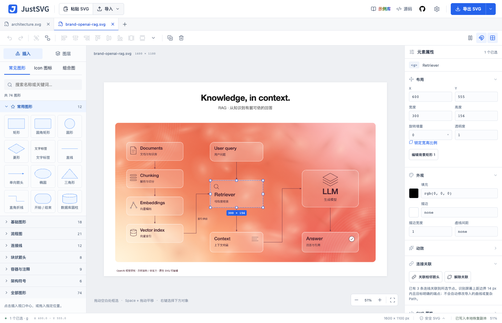
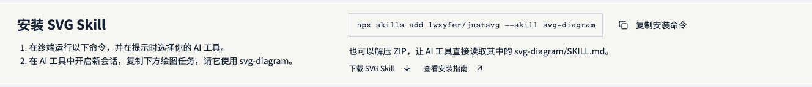
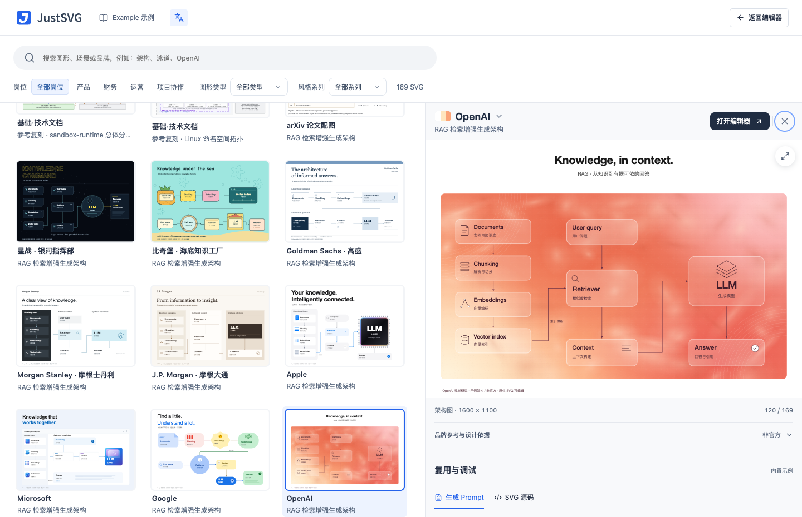

<p align="center">
  <picture>
    <source media="(prefers-color-scheme: dark)" srcset="public/brand/justsvg-wordmark-inverse.svg" />
    
  </picture>
</p>

<h1 align="center">JustSVG</h1>

<p align="center"><strong>用 AI 画技术图，用原生 SVG 继续编辑。</strong></p>

<p align="center">
  <a href="https://justsvg.vercel.app/editor"><strong>打开编辑器</strong></a> ·
  <a href="#安装-svg-diagram-skill">安装 Skill</a> ·
  <a href="https://justsvg.vercel.app/examples">浏览示例</a> ·
  <a href="README.md">English</a>
</p>

JustSVG 是开源的技术图编辑器，适合画架构图、流程图和信息图。用 SVG Diagram Skill 在你的 AI 工具中生成初稿，再用浏览器编辑器改文字、移动节点和调整连线。导出的是标准 SVG，保留可编辑的文字、图形和分组。在线编辑无需注册。

[](https://justsvg.vercel.app/editor)

## 试着改一张图

打开[可编辑的 RAG 示例](https://justsvg.vercel.app/examples?example=brand-openai-rag)，选择「在编辑器中打开」。双击文字修改标签，拖动节点看看已关联的连线如何跟随，再导出 SVG 放进 README、技术文章或演示文稿。也可以从自己的 SVG 文件开始。[编辑器使用指南](docs/EDITOR_GUIDE.zh-CN.md)

## 安装 SVG Diagram Skill

在终端运行以下命令，按提示选择支持 Skill 的 AI 工具。

```sh
npx skills add lwxyfer/justsvg --skill svg-diagram
```

开启新的 AI 会话，请它使用 `svg-diagram`。例如「把这个仓库的请求处理流程画成可编辑的 SVG 架构图，标出根据代码推断的关系。」Skill 输出图稿、生成指令和检查记录，再把 SVG 拖入 JustSVG 修改细节。

也可以[下载 Skill ZIP](https://justsvg.vercel.app/skills/svg-diagram-skill.zip)，解压后让 AI 工具读取 `svg-diagram/SKILL.md)。[网页安装指引](https://justsvg.vercel.app/#skill) · [安装文档](skills/svg-diagram/README.md)

[](https://justsvg.vercel.app/#skill)

## 找一个可复用的起点

- [Agent Evals 案例](skills/svg-diagram/examples/agent-evals/README.md)把同一套评估流程画成三种布局，每版都附 SVG、Prompt 和验证报告。
- [示例库](https://justsvg.vercel.app/examples)收录 169 份可编辑图稿、66 种风格，可用来找构图、改样式或复用生成指令。品牌风格图是基于公开视觉参照创作的研究示例。
- [业务示例](docs/BUSINESS_EXAMPLES.md)覆盖产品、财务、运营和项目协作。利润瀑布图和预算对比图可以改数据并重新计算。
- [组合模板](docs/COMPOSITE_TEMPLATES.md)提供可直接插入的架构、流程和图表组件。

[](https://justsvg.vercel.app/examples)

JustSVG 当前处于 Beta，面向桌面浏览器。支持导入、编辑和导出 SVG，图稿恢复副本保存在浏览器中。长期保存请导出 SVG。可导入文件的范围见[编辑器兼容性说明](docs/EDITOR_GUIDE.zh-CN.md#安全与兼容性)。

欢迎提交可复现问题、兼容性案例或新图稿。[报告问题](https://github.com/lwxyfer/justsvg/issues/new) · [开发与贡献指南](development.md)

## 许可

JustSVG 源代码采用 [MIT](LICENSE)。图标、字体和其他依赖保留各自许可，详见 [第三方许可](docs/THIRD_PARTY.md)。
