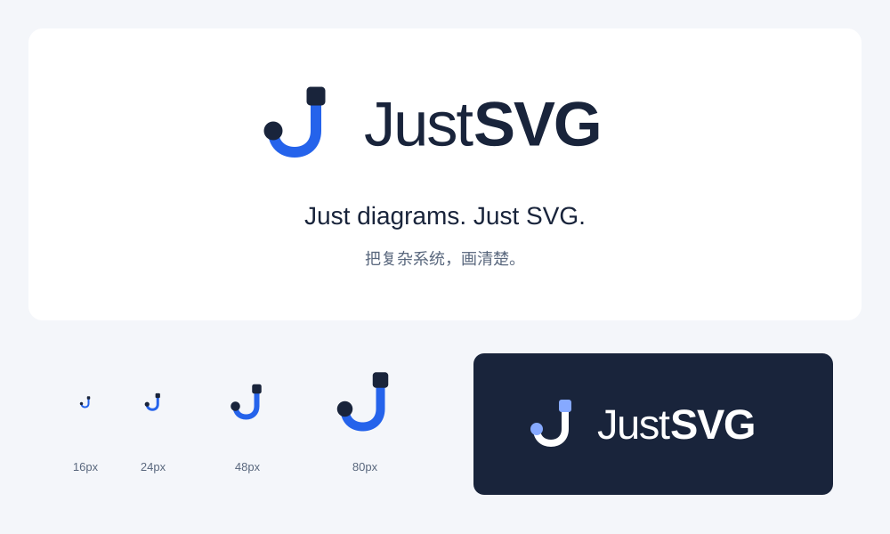

# JustSVG 品牌与 Logo

用户确定名称：**JustSVG**。仓库与包名：`justsvg`。

**Just diagrams. Just SVG.** / **把复杂系统，画清楚。**

JustSVG 是 SVG 原生的 Diagram 创建与编辑工具，面向架构图、流程图、信息图，以及技术框架、产品和代码仓库的结构表达。品牌风格与场景模板帮助用户快速开始；SVG 是可携带、可继续编辑的文档基础。产品目标是 draw.io 的替代方案，当前不读取 `.drawio` 工程文件，不以完整矢量插画工具为目标。

## 记忆点：一条 J，两个节点

J 形路径连接一个方形节点与一个圆形节点：J 对应 JustSVG，节点和连接直接对应 Diagram。轮廓简单，能在16px站点图标与紧凑工具栏中保留特征。标志全部由原生路径、矩形和圆组成，不依赖字体、位图或滤镜。

| 文件 | 用途 |
| --- | --- |
| `public/brand/justsvg-logo.svg` | 64×64透明主标志 |
| `public/brand/justsvg-logo-mono.svg` | 单色印刷或中性场景 |
| `public/brand/justsvg-logo-inverse.svg` | 深色背景反白 |
| `public/brand/justsvg-wordmark.svg` | 横排主字标 |
| `public/brand/justsvg-wordmark-inverse.svg` | 横排反白字标 |
| `public/brand/justsvg-brand-board.svg` | 标志、口号、小尺寸与反白示意 |
| `public/favicon.svg` | 自动适配浏览器明暗主题的站点图标 |

主蓝 `#2563eb`，深墨 `#19243b`，反白节点蓝 `#86a9ff`。标志推荐24–32px，最小16px；四周建议至少留出8/64边长的空间，不拉伸、不旋转、不添加阴影或渐变。字标的Just使用较轻字重、SVG使用较重字重；文字保留可编辑text，使用本机Helvetica Neue/Arial回退，独立标志不受字体影响。

GitHub README使用picture的深色主题反白字标与浅色默认字标，避免透明图片中的深色文字在深色页面失去对比。

应用内 `src/components/Brand.tsx` 复用相同标志与字标布局。原有 `svg-finisher.*` localStorage键、内部拖放MIME和 `data-sf-*` 文档元数据保留，避免更名破坏已有作品。

名称经用户明确选定。无域名购买或商标独占声明；本项目与其他同名SVG工具无关联。

