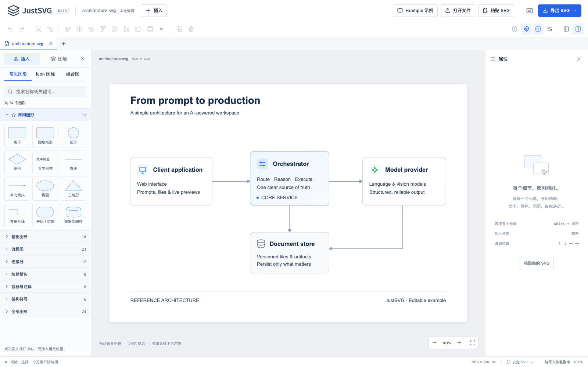
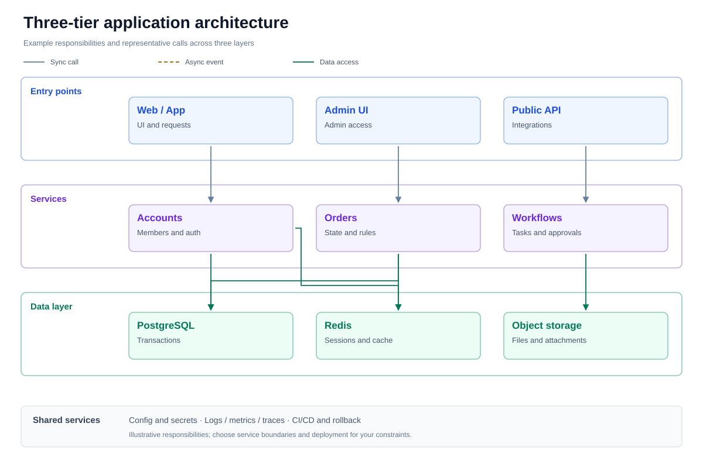

# Keep the next diagram edit with your README

[中文](editable-svg-workflow.zh-CN.md)

A service in an architecture diagram gets renamed. The change is one label, but if the only file you kept is a PNG, you need to find the original drawing project before making it.

I'm building JustSVG, an open-source, SVG-native diagram editor for architecture diagrams, flowcharts and infographics. You can start from a blank canvas, an example or an existing SVG, edit it in the browser, and keep the resulting SVG file. Here is one way to use it for README diagrams.



## Start with an editable source

Download the [architecture SVG](https://raw.githubusercontent.com/lwxyfer/justsvg/main/docs/guides/diagrams/architecture.en.svg), or get the [full diagram starter kit](https://github.com/lwxyfer/justsvg/releases/download/v1.0.0-beta.1/justsvg-starter-kit.zip). The kit includes architecture, release-flow and infographic examples, each with English and Chinese labels.

Open the [editor](https://justsvg.vercel.app/editor) and import the downloaded SVG using **Open file**. The example separates entry points, services and data responsibilities. Adapt these illustrative responsibilities to your own system.



Try three changes:

1. Double-click **Orders** and change the label to **Billing**.
2. Select and move the whole service node, then inspect its bound connections.
3. Export SVG, import the exported file again, and edit the label once more.

Keep the third step. A good-looking preview does not tell you whether the exported file will still support your next edit. Save the SVG itself for long-term storage; browser-local recovery is not a replacement for a file archive.

## Keep the diagram beside the document

One arrangement is to store the source at `docs/diagrams/architecture.svg` and reference it from the README:

```markdown

```

When a service name changes, import the same file, edit it, and commit the updated SVG alongside the documentation. Keeping native text and named groups makes individual parts easier to select and change later.

The supplied architecture example includes bound connector metadata. An SVG from another source may not have those bindings: importing ordinary lines does not automatically create node relationships. Check imported artwork, especially complex SVG, in the editor before relying on the result.

## If you want an AI-generated first draft

JustSVG also includes a separate SVG Diagram Skill. It runs in your own supporting AI tool and can produce a draft to refine in the editor. The website itself does not call an AI model. You do not need the Skill to work from an example or an existing file.

I maintain JustSVG. Feedback on text editing, SVG imports and connectors is welcome, particularly with a small reproducing file and steps.

[Source](https://github.com/lwxyfer/justsvg) · [Try the editor](https://justsvg.vercel.app/editor) · [Report an issue](https://github.com/lwxyfer/justsvg/issues)
