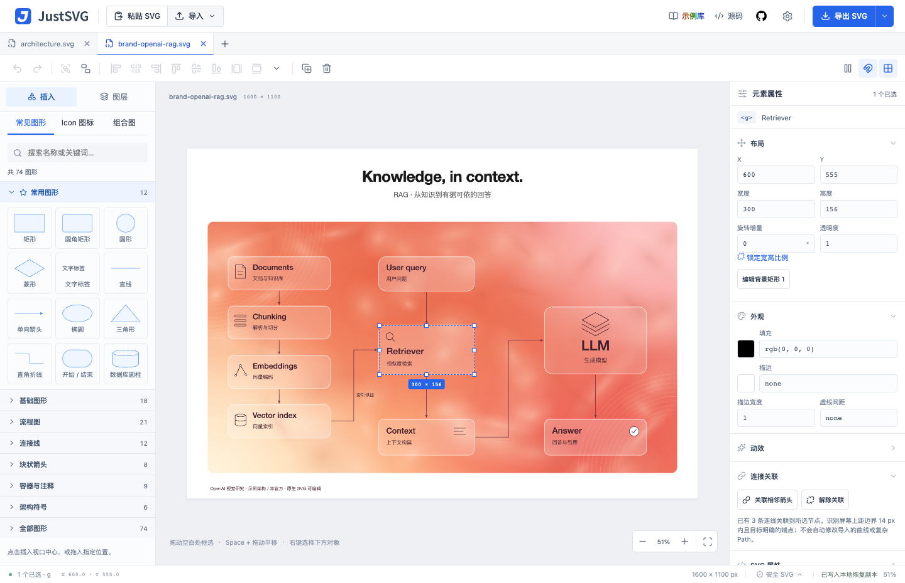
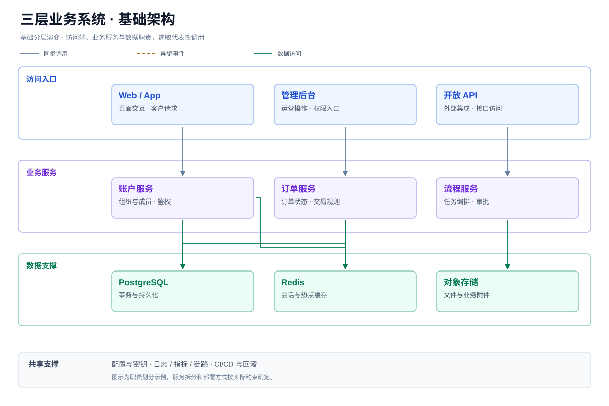

# 给 README 配图，也把下一次修改留好

[English](editable-svg-workflow.en.md)

架构图里的服务改名了，只需要改一个标签。如果保存下来的只有 PNG，这个小修改就要回到最初的绘图工具里找工程文件。

我在做 JustSVG，一个开源的原生 SVG 图表编辑器。它适合创建架构图、流程图和信息图；可以从空白画布、示例或已有 SVG 开始，在浏览器里编辑，再把 SVG 文件带走。这里分享一种给 README 配图的用法。



## 从一张可修改的源图开始

可以直接下载[架构图 SVG](https://raw.githubusercontent.com/lwxyfer/justsvg/main/docs/guides/diagrams/architecture.zh-CN.svg)，也可以下载[完整图表入门包](https://github.com/lwxyfer/justsvg/releases/download/v1.0.0-beta.1/justsvg-starter-kit.zip)，里面有架构图、发布流程图和信息图，各有中英文版。

打开[编辑器](https://justsvg.vercel.app/editor)，用「打开文件」导入下载的 SVG。这张示例说明访问入口、业务服务和数据层的职责，可以按你自己的系统调整。



试着做三处修改：

1. 双击「订单服务」，把文字改成你自己的模块名称。
2. 选中整个服务节点并移动，检查与它关联的连线。
3. 用「导出 SVG」保存，重新导入导出的文件，再修改一次文字。

第三步值得保留：需要确认带走的文件仍可继续编辑，不能只看导出时的预览。长期保存请保留 SVG 文件；浏览器内的恢复副本不能代替文件归档。

## 图稿和文档一起维护

可以把源图放在仓库的 `docs/diagrams/architecture.svg`，在 README 中用相对路径引用：

```markdown

```

下次服务改名时，导入同一个文件，修改后覆盖源图，并和对应文档一起提交。保留原生文字和命名分组，能让后续选择和修改更直接。

入门包的架构图保留了关联连线信息。其他来源的 SVG 是否具备这种关联，需要看文件本身；导入普通线条并不会自动建立节点关系。复杂 SVG 的导入效果也需要实际检查。

## 想先用 AI 起稿时

JustSVG 也附带独立的 SVG Diagram Skill，可以在你自己的 AI 工具里生成初稿，再导入编辑器修改。网页编辑器本身不调用 AI；从示例或已有文件开始，不需要安装 Skill。

我是项目作者。欢迎试用，也欢迎提供一个最小 SVG 和复现步骤，反馈文字编辑、文件导入或连线问题。

[源码](https://github.com/lwxyfer/justsvg) · [在线编辑](https://justsvg.vercel.app/editor) · [报告问题](https://github.com/lwxyfer/justsvg/issues)
