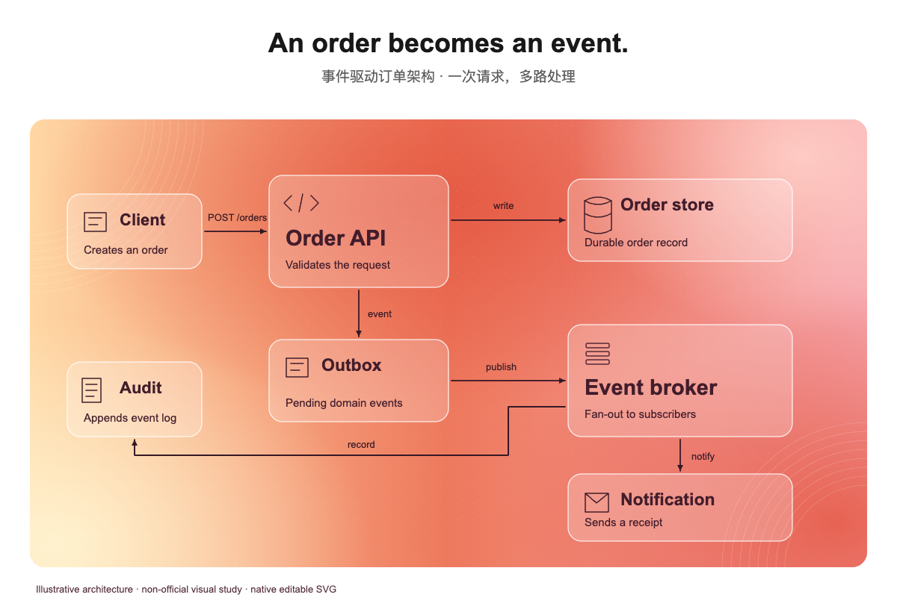
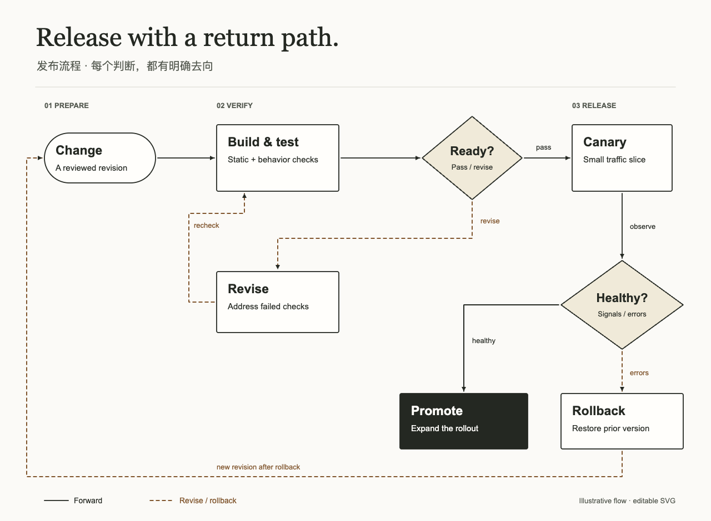

# SVG Diagram Skill

从具体内容与视觉参照生成可编辑的原生 SVG Diagram：架构图、流程图、信息图、技术框架、产品与仓库结构图。可独立使用，不依赖 JustSVG 应用、现有 RAG 生成器、付费 API 或 MCP 服务。

入口为 [SKILL.md](SKILL.md)。工作流是：明确参照 → 分离语义与布局 → 原生 SVG 与完整 Prompt → 浏览器检查 → 有上限的修正 → 分开记录技术结果与视觉差距。品牌灵感需要落实到构图、尺度、字体、线条、形状、材质、图标与阅读节奏。

## 直接调用与安装

无需安装也可在支持读取本地文件的代理中使用：

```text
请读取 /绝对路径/svg-diagram/SKILL.md，并按它生成一张支付事件架构图。
内容：客户端 → 支付 API → 事件队列 → 通知服务，支付 API 另写数据库。
采用我提供的具体截图作为参照；输出 SVG、完整 Prompt 与检查记录。
```

在 JustSVG 仓库内，入口路径是 `skills/svg-diagram/SKILL.md`。这个发布目录本身不会因为叫 `skills/` 就被 Codex 自动发现。若要本仓库自动发现，可从仓库根目录创建指向发布目录的链接（已有同名目录时先检查它）：

```sh
mkdir -p .agents/skills
ln -s ../../skills/svg-diagram .agents/skills/svg-diagram
```

或者把整个 `svg-diagram` 文件夹复制到目标项目的 `.agents/skills/`，或个人的 `~/.agents/skills/`。保留全部参考、脚本、示例和 LICENSE；不要只复制入口。Codex 支持这些目录与符号链接，可显式使用 `$svg-diagram`，也可按描述自动选用；若未显示，重新加载客户端。[官方本地 Skill 发现与调用说明](https://learn.chatgpt.com/docs/build-skills)（2026-10-26 核对）。

安装后示例：

```text
$svg-diagram 根据当前仓库实际文件绘制模块依赖图。
用无品牌技术文档风格，清楚标出推断的职责；不要虚构调用关系。
```

```text
$svg-diagram 绘制含审批分支、失败返工和回滚的发布流程。
沿用 examples/release-flow.svg 的纸墨规则，重新安排我给出的流程。
```

```text
$svg-diagram 把同一个语义图做成两个视觉版本：
版本一参照我给的官网截图，版本二参照我给的文章封面。
保留语义，允许构图、尺度、对象和路线独立变化，并记录来源差异。
```

这里提供本地目录分发，不声称已发布到插件目录或已上传 GitHub。需要跨产品的一键安装时，可另行按目标平台打包插件。

## 包内内容

| 路径                              | 用途                                                          |
| --------------------------------- | ------------------------------------------------------------- |
| `SKILL.md` / `agents/openai.yaml` | 可发现的技能入口与 UI 元数据                                  |
| `references/style-calibration.md` | 具体参照、八个观察维度、历史教训与未获认可的边界              |
| `references/prompt-template.md`   | 可复制的完整生成 Prompt 模板                                  |
| `references/svg-contract.md`      | 原生 SVG、语义与可选 JustSVG 关联协议                         |
| `references/validation.md`        | 命令、依赖、检查覆盖和限制                                    |
| `scripts/validate_svg.py`         | 无依赖结构/引用/语义检查；只检查、不清理原图                  |
| `scripts/render_check.mjs`        | 真实浏览器渲染、几何测量、文字编辑后重新打开                  |
| `scripts/test_*`                  | 安全/语义故障与浏览器几何回归测试                             |
| `examples/`                       | 两张真实试用图，各含 SVG、语义图、完整 Prompt、检查记录和预览 |

## 运行示例

从本目录运行；完整依赖安装与限制见 [validation.md](references/validation.md)。只创作 SVG 不需要脚本依赖。结构检查需 Python 3.10+；自动浏览器检查另需 Node 22+、Playwright 与 Chromium。

```sh
python3 scripts/validate_svg.py examples/event-architecture.svg --graph examples/event-architecture.graph.json
node scripts/render_check.mjs examples/event-architecture.svg --graph examples/event-architecture.graph.json --out /tmp/svg-diagram-event-qa
python3 scripts/validate_svg.py examples/release-flow.svg --graph examples/release-flow.graph.json
node scripts/render_check.mjs examples/release-flow.svg --graph examples/release-flow.graph.json --out /tmp/svg-diagram-release-qa
```

若本机只有 Google Chrome，可给浏览器命令加 `--channel chrome`。本次在 Chrome 155 / Chromium 引擎下验证。`--out` 只写预览和 JSON 报告；不会改写源 SVG。缩放预览用于检查整体，原生尺寸用于阅读；390px 缩略图不等于手机端所有标签可读。

## 两次真实试用

| 示例                                            | 内容与独立构图                                                        | 检查记录                                                                                        |
| ----------------------------------------------- | --------------------------------------------------------------------- | ----------------------------------------------------------------------------------------------- |
| [事件订单架构](examples/event-architecture.svg) | 7 节点 / 6 关系，1200×820；暖色封面灵感，API 与事件总线为不同尺度焦点 | [Prompt](examples/event-architecture.prompt.md) · [记录](examples/event-architecture.checks.md) |
| [发布与回滚流程](examples/release-flow.svg)     | 8 节点 / 9 关系，1280×940；原创无品牌纸墨排版，两个判断和两条返向路径 | [Prompt](examples/release-flow.prompt.md) · [记录](examples/release-flow.checks.md)             |





两张示例保持原生文字/分组/内部引用，没有位图与外部字体依赖。暖色案例依据项目已有的 2026-10-25 有效博客截图，是历史参照的原创适配，未宣称精确复制原纹理、当前页面或官方品牌标准。发布流程不冒称 Notion 风格。

本次入口验证通过；9 项 Python 结构/语义故障测试、9 项浏览器与 CLI 测试及脚本 ESLint 通过。后者覆盖变换坐标、穿字/穿节点、隐藏语义、覆盖缺失，以及失败退出码、源文件不改写和符号链接调用。测试通过不等于风格获用户认可；具体限制与观察分别写入两张图的检查记录。

两张图还从独立解压包重新渲染通过，原生截图与最终预览逐字节一致；运行时只复用了调用项目的 Playwright，未读取 JustSVG 编辑器、生成器或本机私有视觉资料。

## 分享与许可

分享整个目录即可。在其上一级目录可生成压缩包：

```sh
zip -r /tmp/svg-diagram.zip svg-diagram -x '*/__pycache__/*' '*.pyc'
```

代码、说明与原创示例沿用 [MIT License](LICENSE)。包内未分发第三方封面、品牌 Logo 或专有字体。技术通过、视觉复核、官方认证和用户审美认可分别记录，不能互相代替。
