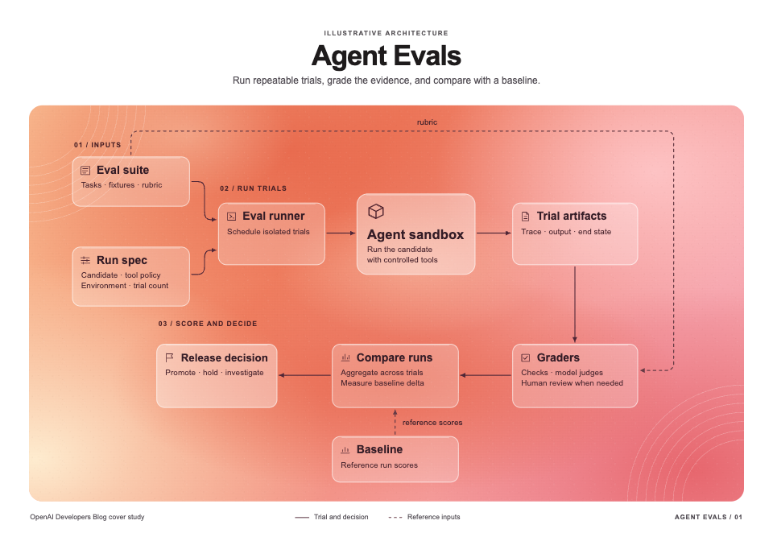
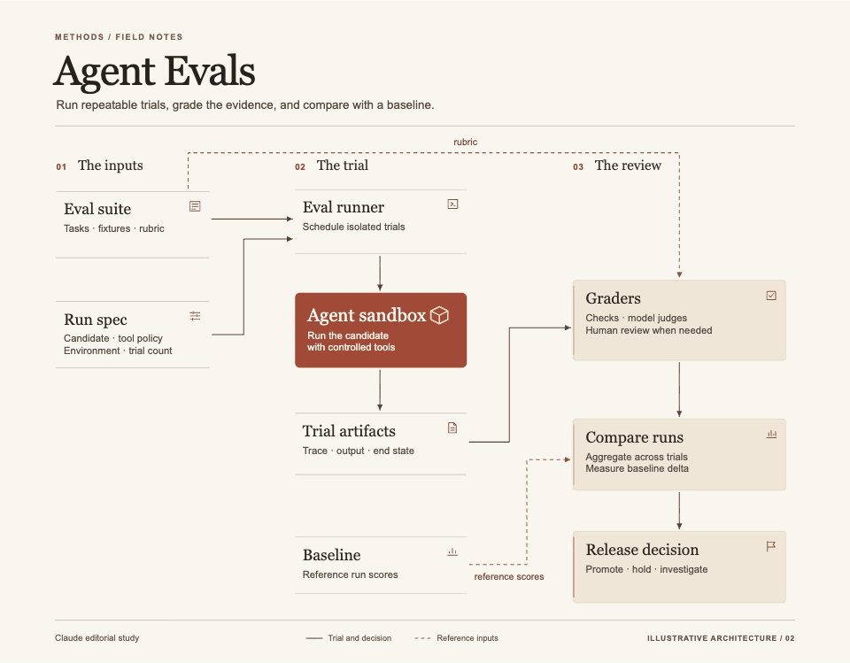
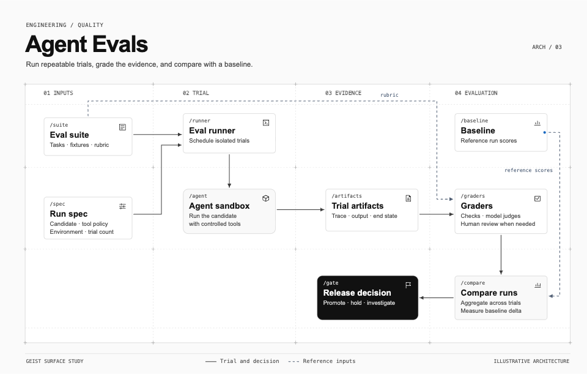

# SVG Diagram

Deliver a useful diagram as portable SVG, with a reproducible prompt and evidence of what was checked. Work independently of JustSVG; its connector bindings are optional.

## Establish the brief

Extract the audience, communication goal, required facts and relationships, output location, language, and visual reference. Infer routine layout choices. Ask only when a missing fact changes meaning or the reference cannot be identified; continue independent work while waiting. With no reference, choose an unbranded diagram language appropriate to the medium and state that choice.

For a named brand, follow [brand lookup and discovery](references/brand-lookup.md). Use the user's exact screenshot or URL first. With a brand name alone, resolve its catalog profile or find a relevant official surface for the requested diagram. Ask only when competing interpretations materially change the result or usable evidence is missing and fidelity matters.

For branded work or a supplied visual, apply [style calibration](references/style-calibration.md). Pin the exact surface and record which evidence was inspected, when it was captured or read, and what could not be verified.

## Separate meaning from presentation

Record the semantic structure appropriate to the diagram. Use nodes, directions and branch labels for flows, ordered messages for sequence diagrams, row/column assignments for matrices, and values, units and scales for charts. Preserve this structure across styles. For repository maps, ground claims in inspected files and label inferred responsibilities.

Choose composition, focal scale, type hierarchy, line language, silhouette, material, icon vocabulary and reading rhythm from the reference and the actual content. Allocate node/text boxes and connector corridors before drawing details. Place branch labels beside the route they explain. A style comparison needs structural visual differences beyond a recolored template; a content comparison need not invent a new style.

## Author the SVG and prompt

Read [references/svg-contract.md](references/svg-contract.md) before generating markup. Use native `text`/`tspan`, named `g` groups, unique IDs, and local `defs` references. Keep text editable, resources self-contained and font fallbacks explicit. Use original vector symbols for concepts; brand-inspired artwork does not require a brand logo.

Write the complete generation prompt using [references/prompt-template.md](references/prompt-template.md): resolved content, visual rules, actual geometry/routes, sources and adaptation limits. Save it alongside the SVG, rather than leaving critical instructions only in chat. Choose canvas dimensions from density and reading size; the packaged examples' sizes and counts are examples only.

## Render, inspect, repair

Use [references/validation.md](references/validation.md) for commands, helper metadata, and limits. Run structural validation before opening generated SVG. Then render in a browser; inspect the whole composition at fit size and lettering, route labels, arrow tips, alignment and spacing at native size. If the supplied browser helper is unavailable, use another real browser and record the missing automated checks.

Check **two separate outcomes**:

- Technical: exact semantic coverage, valid references, editable text/groups, readable bounds, clear nodes and routes, correct arrow direction and legend. Include at least one real text edit → serialize → reopen check when editability is promised; verify connector movement in the target app only when bindings are requested.
- Visual: compare against the pinned evidence on composition, scale, typography, lines, shapes, material, icons and rhythm. Name observations as match, deliberate adaptation, gap or unknown. Tests alone cannot establish this outcome or user acceptance.

Collect concrete defects, fix them in one batch, and re-render affected views. Default to at most two repair batches; if a substantive defect remains, deliver the usable work with the exact gap or ask for the missing input. Change the bound when the user requests further refinement. Avoid repeated preference-only micro-adjustments after the defined checks pass.

## Deliver

Provide the `.svg`, full `.prompt.md`, and a concise check record with sources, completed checks, visual gaps and renderer/font limits. Keep the semantic graph as a sidecar when it aids reuse or comparison. If the user requests only XML, return only the complete SVG and keep supporting artifacts in the requested workspace when available. Distinguish technical success, visual review, and explicit user approval.

See [README.md](README.md) for installation and runnable examples, including the Linear release-flow transfer.

## Example previews

One Agent Evals architecture, composed in three styles. [Open the editable SVGs, prompts and validation reports](https://github.com/lwxyfer/justsvg/tree/111b20dfee17f0c849a27d349248082ef717871b/skills/svg-diagram/examples/agent-evals).

**OpenAI Developer Blog**

**Claude**

**Vercel Geist**

